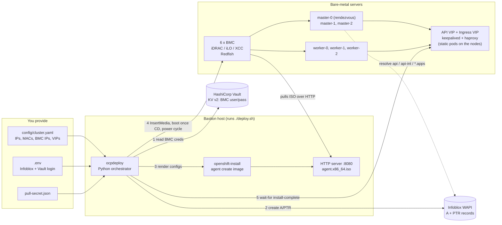
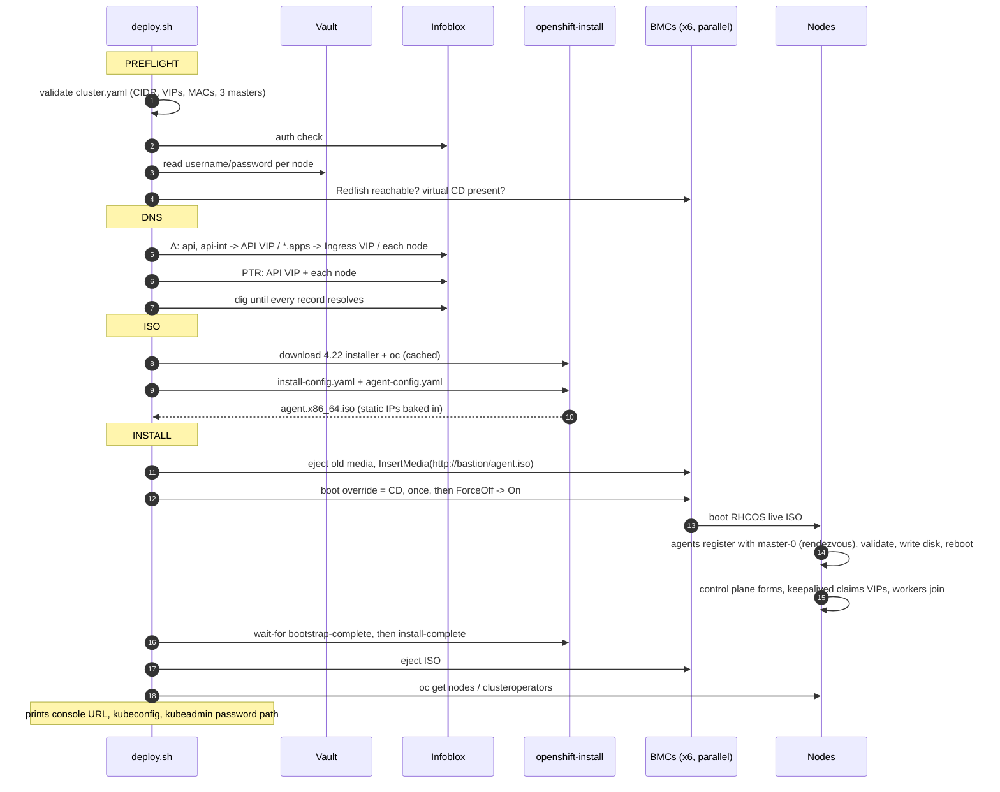

# ocp-baremetal-autodeploy

One command builds an OpenShift **4.22** cluster (3 masters + 3 workers) on bare-metal
servers, hands-off:

```bash
./deploy.sh
```

It reads BMC passwords from **Vault**, creates DNS in **Infoblox**, builds an
**Agent-based Installer** ISO, mounts it on every server over **Redfish** virtual media,
power-cycles them, and waits until the cluster is up. Load balancing is OpenShift's own
in-cluster **keepalived + haproxy** (`platform: baremetal` with API/Ingress VIPs) — no
external LB, no PXE/DHCP, no separate bootstrap node.

## Architecture



## End-to-end flow



| Stage | What it does | Safe to re-run |
|---|---|---|
| `preflight` | Validates config; proves Vault, Infoblox and every BMC are reachable before anything changes | yes (read-only) |
| `dns` | Creates/repairs 9 A records and 7 PTR records, then waits until they resolve | yes (idempotent) |
| `iso` | Renders both installer inputs and builds the agent ISO | yes (reuses an ISO < 20 h old; `--force` rebuilds) |
| `install` | Serves ISO, mounts it via Redfish, power-cycles all 6 nodes, waits, ejects, verifies | **no — wipes the nodes' disks** |

## Repository structure

```
ocp-baremetal-autodeploy/
├── deploy.sh                    # entry point: creates venv, runs the pipeline
├── .env.example                 # Infoblox + Vault credentials  -> copy to .env
├── config/
│   └── cluster.example.yaml     # cluster, network, nodes       -> copy to cluster.yaml
├── ocpdeploy/
│   ├── __main__.py              # CLI + the four stages
│   ├── config.py                # load + validate cluster.yaml
│   ├── vault.py                 # Vault KV v2 reader (token or AppRole)
│   ├── infoblox.py              # idempotent A / PTR via WAPI
│   ├── render.py                # install-config.yaml + agent-config.yaml (NMState)
│   ├── redfish.py               # virtual media, one-time boot, power
│   └── installer.py             # download tools, build ISO, serve ISO, wait-for
├── tests/                       # pytest: rendering, validation, Redfish + Infoblox fakes
└── requirements.txt
```

Runtime output goes to `work/<cluster>/` (git-ignored): `bin/` (installer, oc),
`rendered/` (copies of both YAMLs), `install/` (ISO, `auth/kubeconfig`,
`auth/kubeadmin-password`).

## Prerequisites

**Bastion** (RHEL 9 / Rocky 9 / Fedora, x86_64):

- `dnf install -y python3 nmstate bind-utils openssh-clients`
- Outbound HTTPS to `mirror.openshift.com` and `quay.io` / `registry.redhat.io`
- HTTPS to every BMC, to Vault and to Infoblox
- **Every BMC must be able to reach the bastion on TCP 8080** (open the firewall:
  `firewall-cmd --add-port=8080/tcp`)

**Servers:** UEFI boot, Redfish and virtual media enabled, install disk empty or
disposable, primary NIC name and MAC known.

**Network:** node IPs, both VIPs and the gateway in one L2 subnet (VRRP needs it);
the two VIPs unused; NTP reachable.

**Infoblox:** forward zone for `base_domain` and the reverse zone for the machine
subnet already exist; the service account can write A and PTR records.

**Vault:** one KV v2 secret per node with keys `username` and `password`:

```bash
vault kv put secret/baremetal/master-0 username=root password='...'
```

## Usage

```bash
git clone <this repo> && cd ocp-baremetal-autodeploy
cp .env.example .env                                   # Infoblox + Vault login
cp config/cluster.example.yaml config/cluster.yaml     # IPs, MACs, BMCs, VIPs
cp ~/Downloads/pull-secret.txt pull-secret.json

./deploy.sh deploy --dry-run     # validate + show every DNS record and action
./deploy.sh preflight            # prove Vault / Infoblox / all BMCs work
./deploy.sh                      # full build
```

Other commands: `./deploy.sh render` (write the two YAMLs for review),
`./deploy.sh dns-delete` (remove the cluster's records), `-v` for debug logs.

When it finishes:

```bash
export KUBECONFIG=$PWD/work/<cluster>/install/auth/kubeconfig
oc get nodes
```

## How long it takes

Automation overhead is about 3–5 minutes (preflight, DNS, ISO build, Redfish). The rest
is the OpenShift install itself, and on physical servers each node goes through two
firmware POSTs. Expect roughly **45–70 minutes** door to door on typical hardware.
A consistent 30 minutes is not realistic for a 3+3 bare-metal cluster. What shortens it:

- **Mirror registry on the same LAN** (biggest win — image pulls dominate the install)
- NVMe/SSD install disks and 10 GbE or faster
- Trim POST time in BIOS (disable unused option ROMs / PXE on unused NICs, memory fast-boot)
- Keep the ISO cached (`iso` stage is skipped when a fresh one exists)

## Troubleshooting

| Symptom | Check |
|---|---|
| `InsertMedia: HTTP 4xx/5xx` | BMC cannot reach `http://<iso_host>:8080` — firewall or routing; virtual-media license (iLO Advanced, iDRAC Enterprise) |
| Node boots old OS, not the ISO | Boot mode is legacy BIOS, or one-time boot not honoured — set UEFI; update BMC firmware |
| `wait-for` stuck on host validation | `ssh -i work/<cluster>/id_ed25519 core@<master-0 ip>` then `journalctl -u assisted-service -f`; usually wrong `interface`/`mac`, NTP, or DNS |
| Wrong install disk | Set `root_device` per node (e.g. `/dev/nvme0n1`) |
| DNS stage times out | Reverse zone missing in Infoblox, or wrong `dns_view` |
| Rebuild after a failed run | Fix the cause, then `./deploy.sh deploy --force` |

## Scope and limits

- Single L3 interface per node, optionally VLAN-tagged (`network.vlan_id`). Bonds need an
  extra NMState block in `render.py`.
- Redfish calls use the DMTF standard schema (iDRAC9, iLO 5/6, XCC, Supermicro X12+).
  Older Supermicro firmware uses a proprietary virtual-media API and is not covered.
- Connected install. For disconnected sites add `imageDigestSources` and
  `additionalTrustBundle` to `render.install_config()`.
- The agent ISO contains the pull secret and is served over plain HTTP on the management
  network for the duration of the install only.

## Tests

```bash
pip install -r requirements.txt pytest && pytest -q
```
